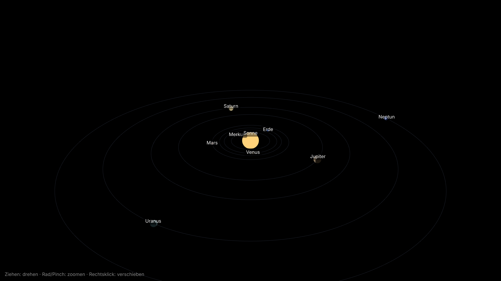

# Sonnensystem 3D

Interaktive 3D-Simulation des Sonnensystems im Browser – frei dreh- und erkundbar.
Stack: Three.js · TypeScript · Vite · Vitest · GitHub Actions/Pages.



## Entwicklung

```bash
npm ci
npm run dev      # Dev-Server
npm test         # Unit-Tests
npm run lint
npm run build    # Typecheck + Produktions-Build nach dist/
```

## Architektur

- `src/data/bodies.json` – Himmelskörper als Daten (Radius km, große Halbachse AU, …)
- `src/scale.ts` – einzige Stelle, die physikalische Größen auf Szenen-Einheiten abbildet (komprimierter Maßstab)
- `src/layout.ts` – M1-Platzhalter für Positionen, wird in M2 durch Kepler-Bahnen ersetzt
- `src/scene/` – Three.js-Objekte (Körper, Labels, Bahnlinien)

## Roadmap

- [x] M0 Grundgerüst: Vite/TS/Three.js, Lint, Tests, CI + Pages-Deploy
- [x] M1 Statisches Sonnensystem: Sonne + 8 Planeten, komprimierter Maßstab, Labels, OrbitControls
- [ ] M2 Bahnmechanik: Kepler-Elemente (JPL), Zeit-Engine, Bahnellipsen, Tests gegen Horizons
- [ ] M3 Navigation: Klick-Fokus, Fly-to, Follow, Floating Origin
- [ ] M4 Visuals: Texturen, Rotation/Achsneigung, Saturnringe, Bloom, Skybox
- [ ] M5 Maßstab real ↔ komprimiert
- [ ] M6 Monde, Zwergplaneten, Asteroidengürtel
- [ ] M7 Info-Panel, Touch, Performance
- [ ] M8 Stretch: VSOP87, Raumsonden, WebXR, N-Body-Sandbox
